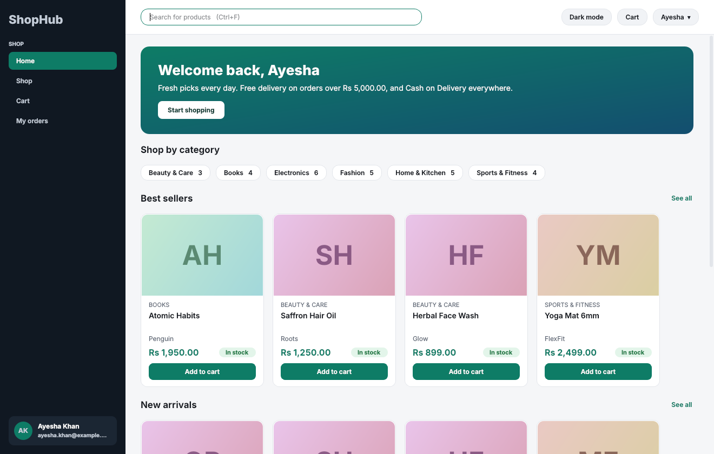
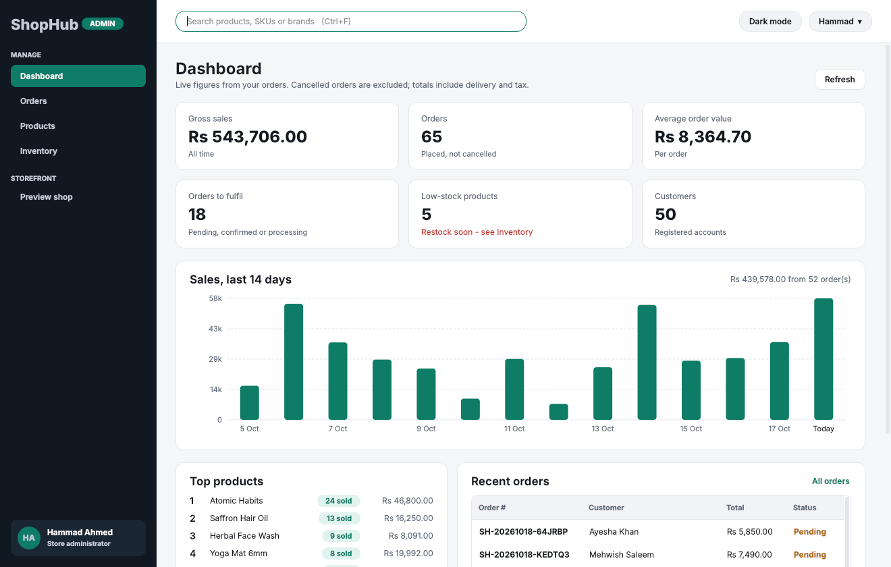
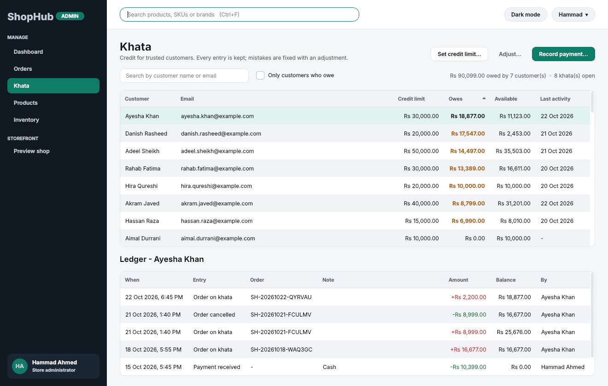
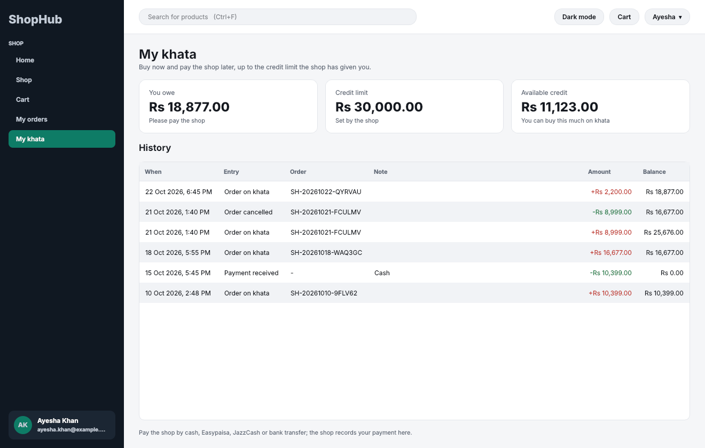
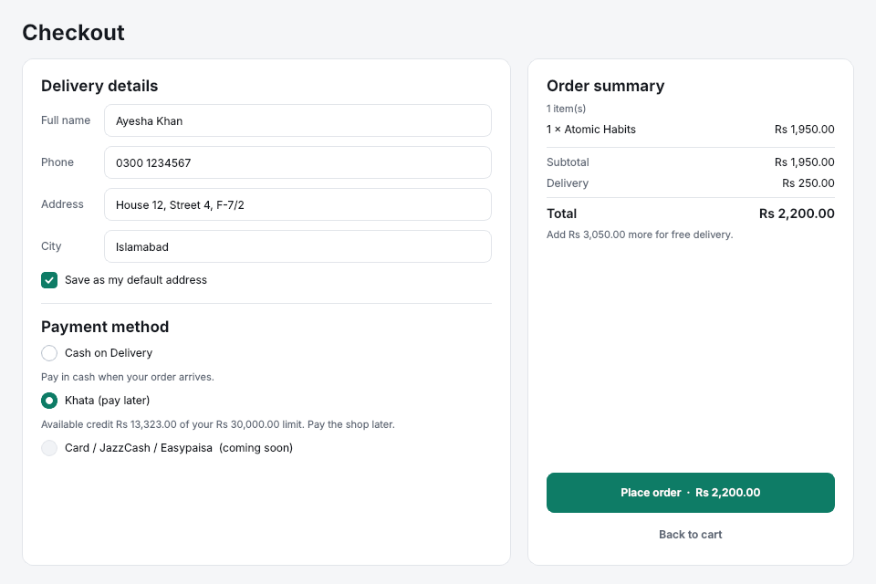
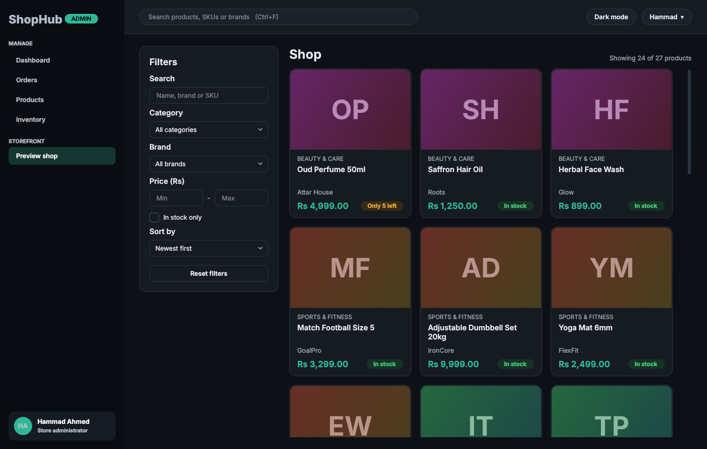

# ShopHub

A desktop e-commerce application built with **C++17**, **Qt 6 Widgets** and **SQLite**.
Customers browse a catalog, keep a cart, check out with Cash on Delivery or on their
**khata** (shop credit) and track their orders. Store admins get a dashboard, product and
category management, inventory with a full stock history, order fulfilment and a khata book.

This is **version 2 - Pakistan Retail Edition** (in progress). Milestones 1 and 2, **Khata** and **wholesale prices**, are done.
See [Roadmap](#roadmap) for what comes next.

| Customer home | Admin dashboard |
|---|---|
|  |  |
| **Khata (admin)** | **My khata (customer)** |
|  |  |
| **Checkout with khata** | **Dark theme** |
|  |  |

More in [`docs/screenshots`](docs/screenshots).

---

## What's new in v2

**Khata (credit book)**, the way Pakistani shops have always sold to regulars:

- The admin gives a trusted customer a **credit limit** (0 = no khata)
- At checkout the customer chooses **Cash on Delivery** or **Khata (pay later)**. Khata is offered
  only when the order fits in their available credit; the limit is checked again when the order is saved
- **My khata** page for customers: what they owe, their limit, available credit and full history
- **Khata** page for admins: every customer with limit, balance and last activity, sorted by who owes most,
  plus each customer's ledger. Record payments (cash, Easypaisa, JazzCash, bank transfer, cheque) and
  adjustments (discount, write-off, correction - a reason is required)
- Cancelling a khata order takes it off the khata automatically
- Dashboard shows **Khata outstanding** and how many customers owe
- The ledger can never be edited or deleted, only corrected with a new entry (enforced by the database)
- Your v1 database is upgraded automatically on first start, keeping all data

**Wholesale prices**, the dozen and carton rates every bazaar shop gives:

- On the Products page, **Quantity prices...** sets up to 5 tiers per product, e.g. *12 or more: 5% off*,
  *50 or more: 10% off*. It shows the price each as you type and warns when a tier falls below the cost price
- Products with quantity prices get a **Wholesale 12+** badge in the shop and a *Buy more, pay less* table
  on the product page
- The cart applies the right price automatically, shows the saving, and offers **"Buy 1 more to pay
  Rs 1,187.50 each"** with a one-click button
- Free delivery and khata limits use the discounted total, and every order keeps the price that was paid,
  even if the tiers change later
- The rules (at most 5 tiers, 2-99 units, more than 0% and at most 90% off, buying more never costs more)
  are checked by the app and enforced by the database. See [`docs/WHOLESALE.md`](docs/WHOLESALE.md)

## Features (v1)

**Customers**
- Register, sign in, change password (accounts lock for 15 minutes after 5 failed attempts)
- Home page with best sellers, new arrivals and category shortcuts
- Shop with search (name, brand, SKU), category, brand, price range, in-stock filter, sorting and paging
- Product details with stock status
- Persistent cart (kept between sessions), quantity changes, stock checks, free-delivery hint
- Checkout with saved delivery address and Cash on Delivery
- My orders: status, status history, cancel while still Pending or Confirmed

**Admins**
- Dashboard: gross sales, orders, average order value, orders to fulfil, low stock, customers, 14-day sales chart, top products, recent orders
- Products: create, edit, hide/show, product images, categories (add, rename, activate/deactivate)
- Inventory: restock, damaged/lost, corrections, with a movement log (who, when, why)
- Orders: filter and search, move through Pending → Confirmed → Processing → Shipped → Delivered, cancel with automatic restock

**Under the hood**
- Layered design: GUI → services → repositories → SQLite. No SQL in the GUI, and every role check happens in the services
- Money stored as whole **paisa** (`qint64`), never floating point
- Passwords hashed with **PBKDF2-HMAC-SHA512**, 210,000 iterations, random salt per password
- Checkout is **one database transaction**: order, order lines, stock deduction, stock movements and cart clearing all succeed or all roll back
- Double-click protection: each checkout has a token, so submitting twice never creates two orders
- Versioned database **migrations**, foreign keys switched on and verified, CHECK constraints, immutable order lines
- Light and dark themes, keyboard shortcuts, log file
- 11 automated test suites (unit, database integration and GUI journeys)

---

## Setting up on Windows with VS Code

### 1. Install Qt (one time, about 15-20 minutes)

1. Download the **Qt Online Installer** from <https://www.qt.io/download-qt-installer> and sign in with a free Qt account.
2. Choose **Custom installation** and tick:
   - **Qt → Qt 6.8.x → MinGW 64-bit** (any Qt 6.4 or newer works; 6.8 is the current long-term release)
   - **Qt → Developer and Designer Tools → MinGW 64-bit** (the compiler), **CMake** and **Ninja**
3. Install. Note the folder, normally `C:\Qt`.

### 2. Install VS Code extensions

- **C/C++** (Microsoft)
- **CMake Tools** (Microsoft)
- Optional: **Qt Extension Pack** (The Qt Company), **Claude Code**

### 3. Point the project at Qt

Open the `ShopHub` folder in VS Code, then edit `.vscode/settings.json` and set the path to
**your** Qt version folder (check `C:\Qt` for the exact version number):

```json
"cmake.configureSettings": {
    "CMAKE_PREFIX_PATH": "C:/Qt/6.8.3/mingw_64"
}
```

### 4. Pick the compiler, build and run

1. Press **Ctrl+Shift+P → CMake: Select a Kit** and choose the **MinGW** compiler from
   `C:\Qt\Tools\mingw...`. If it is not listed, run **CMake: Scan for Kits** first.
2. Press **F7** (or click **Build** in the status bar).
3. Press **Shift+F5** (or the ▶ button in the status bar) to run ShopHub.

After each build the Qt DLLs are copied next to `ShopHub.exe` automatically (via `windeployqt`),
so you can also double-click `build\ShopHub.exe` (on a Windows build with Qt 6.11 from MSYS2 the
program landed directly in `build\`; if it is not there, run `dir /s /b build\ShopHub.exe` or
`find build -name ShopHub.exe` to locate it).

### Building from a terminal instead

Open **"Qt 6.8.x (MinGW) command prompt"** from the Start menu (it puts Qt and the compiler on PATH), then:

```bat
cd E:\e-commerence\ShopHub
cmake -S . -B build -G Ninja -DCMAKE_BUILD_TYPE=Release
cmake --build build
build\ShopHub.exe
```

### Alternative: MSYS2 instead of the Qt installer

Install MSYS2, then in the **MSYS2 UCRT64** terminal:

```bash
pacman -S --needed mingw-w64-ucrt-x86_64-gcc mingw-w64-ucrt-x86_64-cmake mingw-w64-ucrt-x86_64-ninja mingw-w64-ucrt-x86_64-qt6-base
cd /path/to/ShopHub          # e.g. /e/e-commerence/ShopHub
cmake -S . -B build -G Ninja -DCMAKE_BUILD_TYPE=Release
cmake --build build
ctest --test-dir build --output-on-failure
./build/ShopHub.exe
```

Tested with GCC 16.2, CMake 4.4 and Qt 6.11.2. In VS Code, set `CMAKE_PREFIX_PATH` to your MSYS2
`ucrt64` folder (for example `E:/ucrt64` or `C:/msys64/ucrt64`).

---

## First run

1. ShopHub asks you to **create the administrator account**. Choose your own email and password.
   No default admin password exists.
2. Leave **"Add sample products, orders and 50 customer accounts"** ticked to get 6 categories,
   27 products (6 with wholesale prices), **50 customer accounts** with Pakistani names and about 75 orders in every state
   (pending to delivered, plus a few cancelled, and 3 bulk orders at wholesale prices) spread over the last three weeks. Setup takes a few seconds.
3. Sign out (top-right menu) and sign in as any sample customer to try shopping.
   Eight of them have a khata, including Ayesha Khan below (limit Rs 30,000).
   **Every sample password is the customer's first name + `123`.** For example:

   | Customer | Email | Password |
   |---|---|---|
   | Ayesha Khan | `ayesha.khan@example.com` | `Ayesha123` |
   | Muhammad Asad | `muhammad.asad@example.com` | `Muhammad123` |
   | Humayun Aslam | `humayun.aslam@example.com` | `Humayun123` |

   The full list of all 50 is in [`docs/CUSTOMER_ACCOUNTS.md`](docs/CUSTOMER_ACCOUNTS.md)
   (also as [`docs/customer_accounts.csv`](docs/customer_accounts.csv) for Excel), together
   with who has a khata and how much they owe.
   Emails use `example.com`, a domain reserved for examples, so they never reach a real person.

> Sample passwords are simple and public. Untick the sample-data box when setting up a real shop.

### Where the data lives

| What | Where on Windows |
|---|---|
| Database | `%APPDATA%\ShopHub\ShopHub\shophub.db` |
| Product images | `%APPDATA%\ShopHub\ShopHub\images\` |
| Log file | `%APPDATA%\ShopHub\ShopHub\logs\shophub.log` |

**To start over**, close ShopHub and delete the `%APPDATA%\ShopHub\ShopHub` folder. The next
launch shows the first-run setup again. To back up, copy that folder while ShopHub is closed.

Pricing rules live in the `app_settings` table: flat delivery Rs 250, free delivery from
Rs 5,000, tax 0% (`tax_rate_bp`, in basis points: `1700` = 17%).

### Keyboard shortcuts

| Keys | Action |
|---|---|
| Ctrl+F | Search |
| F5 | Refresh the current page |
| Alt+1 ... Alt+6 | Jump to a sidebar page |

---

## Running the tests

```bat
cd build
ctest --output-on-failure
```

Or use the **Testing** panel in VS Code (CMake Tools adds the tests there).

| Suite | Covers |
|---|---|
| `tst_money` | Parsing, formatting, rounding of paisa amounts |
| `tst_validation` | Emails, passwords, phones, SKUs, LIKE escaping |
| `tst_pricing` | Delivery threshold, tax rounding, cart problem detection, wholesale tier boundaries, rounding and hints, free delivery on the discounted subtotal |
| `tst_orderstatus` | Allowed and forbidden status transitions |
| `tst_database` | Migrations, foreign keys, CHECK constraints, immutable order lines, wholesale price tiers (rules, triggers, save and load, rollback with and without a transaction), `validate` and the database agree, upgrading a v2 database |
| `tst_auth` | Login, lockout, hashing, duplicate emails, password change, audit log, sample accounts |
| `tst_catalog` | Permissions, validation, search/filters/paging, hidden products, image import, wholesale tiers (admin only, validated, audited, below-cost warnings) |
| `tst_cart_checkout` | Cart rules, checkout totals, price snapshots, duplicate submission, **rollback on failure**, wholesale prices in cart and checkout |
| `tst_orders_inventory` | Cancellation + restock, status flow, privacy between customers, stock adjustments, dashboard maths, sample data (all 50 accounts sign in, wholesale tiers and bulk orders), accounts file matches the app |
| `tst_khata` | Credit limits, khata checkout, over-limit refusal, cancel reversal, advances, payments, adjustments, permissions, immutable ledger, upgrading a v1 database, sample data |
| `tst_gui` | Real windows, offscreen: first-run setup, sign-in, add to cart, checkout (COD and khata), my khata, admin khata payment, admin pages, dark theme, quantity prices editor, wholesale badge, product price table, cart "add 1 more" and checkout at the tier price |

Set `SHOPHUB_SCREENSHOT_DIR=C:\some\folder` before running `tst_gui` to save a screenshot of every screen.

---

## Project structure

```
ShopHub/
├── CMakeLists.txt
├── CLAUDE.md                 rules for Claude Code when working on this repo
├── docs/
│   ├── ARCHITECTURE.md       layers, responsibilities, key decisions
│   ├── DATABASE.md           schema and ER diagram
│   ├── CUSTOMER_ACCOUNTS.md  the 50 sample customer logins (also customer_accounts.csv)
│   └── screenshots/
├── src/
│   ├── core/                 business logic - no GUI code (library: shophub_core)
│   │   ├── common/           Money, Result/Status, validation, logging
│   │   ├── domain/           entities, order status rules, Session
│   │   ├── database/         connection, transactions, migrations
│   │   ├── repositories/     the ONLY place with SQL
│   │   ├── security/         password hashing
│   │   └── services/         auth, catalog, cart, pricing, checkout, orders, inventory, khata, dashboard
│   └── app/                  Qt Widgets GUI (library: shophub_ui) + main.cpp
│       └── ui/               theme, main window, pages, dialogs, widgets, table models
└── tests/                    Qt Test suites
```

---

## Roadmap

**v2 - Pakistan Retail Edition**

1. ~~Khata (credit book)~~ - done
2. ~~Wholesale prices (lower price for bulk quantities)~~ - done
3. Qist (installment plans, built on the khata)
4. Tax invoices with a QR code

Later:

- Suppliers and purchase orders
- Coupons and promotions
- Wishlist, product reviews and ratings
- Reports with CSV/PDF export, audit log viewer
- In-app backup and restore
- Online payments (JazzCash, Easypaisa, cards) through a real payment provider's sandbox
- Multiple addresses per customer, product variants (size/colour)
- Argon2id password hashing (needs an extra library)
- Installer package
- Client-server mode for several computers (a shared SQLite file is not safe for that)

## Known limitations

- Single computer, single user at a time. Do not put the database on a network drive.
- Order numbers use the computer's local date.
- Signing in takes about half a second on purpose (password hashing strength).
