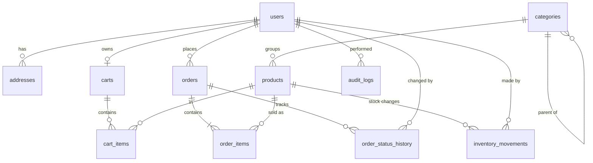

# ShopHub database

SQLite, schema version **1** (`src/core/database/Migrations.cpp`).

- Money columns end in `_paisa` and are INTEGER (Rs 1 = 100 paisa).
- Timestamps are ISO-8601 UTC text, e.g. `2026-10-17T15:30:00Z`.
- Foreign keys are enforced and verified on every connection.

## ER diagram

## Tables

| Table | Purpose | Notable rules |
|---|---|---|
| `schema_migrations` | Applied migration versions | One row per migration |
| `users` | Customers and admins | `email` UNIQUE (case-insensitive), `role` in (customer, admin), lockout fields |
| `addresses` | Default delivery address per customer | Deleted with the user |
| `categories` | Product categories | `name` UNIQUE, `parent_id` reserved for subcategories |
| `products` | Catalog | `sku` UNIQUE, `price_paisa > 0`, `stock >= 0`, `image_file` is a name inside the image store |
| `carts`, `cart_items` | Persistent carts | One cart per user, `quantity` 1-99, PK (cart, product) |
| `orders` | Order header + delivery snapshot | `order_number` and `checkout_token` UNIQUE, `total = subtotal + shipping + tax`, `payment_method = 'cod'` |
| `order_items` | Line snapshots | `line_total = unit_price × quantity`; trigger blocks any update; product link becomes NULL if a product is deleted |
| `order_status_history` | Every status change | Who, when, note |
| `inventory_movements` | Every stock change | `quantity_change <> 0`, `stock_after >= 0`, reason in (initial, restock, adjustment, damaged, sale, cancel_restock) |
| `audit_logs` | Security and admin actions | Logins, lockouts, product/category changes, order changes, stock changes |
| `app_settings` | Key/value settings | `shipping_flat_paisa`, `free_shipping_threshold_paisa`, `tax_rate_bp`, `demo_data_loaded` |

## Indexes

`products(category_id)`, `products(name)`, `products(price_paisa)`, `products(brand)`,
`products(created_at)`, `orders(user_id)`, `orders(status)`, `orders(created_at)`,
`order_items(order_id)`, `order_items(product_id)`, `order_status_history(order_id)`,
`inventory_movements(product_id)`, `inventory_movements(created_at)`, `addresses(user_id)`,
`audit_logs(created_at)`.

## Adding a migration

Append a new `{version, name, statements}` entry to `Migrator::migrations()` with the next version
number. Never edit a migration that has already shipped. Each migration runs in its own transaction.

## Resetting

Close ShopHub and delete `%APPDATA%\ShopHub\ShopHub`. The next start runs every migration on a fresh
database and shows the first-run setup.
