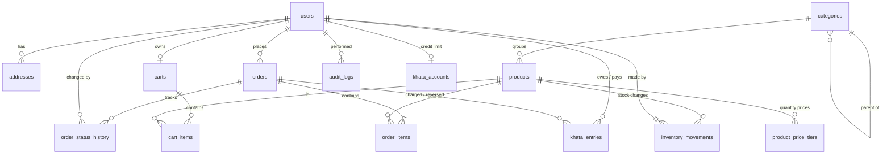

# ShopHub database

SQLite, schema version **4** (`src/core/database/Migrations.cpp`).

| Version | Name | What it does |
|---:|---|---|
| 1 | `initial_schema` | ShopHub v1 tables |
| 2 | `khata_ledger` | Khata: `khata_accounts`, `khata_entries`, and `orders` rebuilt so `payment_method` can be `khata` and `payment_status` can be `on_account` |
| 3 | `wholesale_price_tiers` | Wholesale prices: `product_price_tiers` (quantity discounts per product) |
| 4 | `wholesale_tier_rules` | Triggers on `product_price_tiers`: at most 5 tiers per product, a bigger quantity never gets a smaller discount |

- Money columns end in `_paisa` and are INTEGER (Rs 1 = 100 paisa).
- Timestamps are ISO-8601 UTC text, e.g. `2026-10-17T15:30:00Z`.
- Foreign keys are enforced and verified on every connection.

## ER diagram

## Tables

| Table | Purpose | Notable rules |
|---|---|---|
| `schema_migrations` | Applied migration versions | One row per migration |
| `users` | Customers and admins | `email` UNIQUE (case-insensitive), `role` in (customer, admin), lockout fields |
| `addresses` | Default delivery address per customer | Deleted with the user |
| `categories` | Product categories | `name` UNIQUE, `parent_id` reserved for subcategories |
| `products` | Catalog | `sku` UNIQUE, `price_paisa > 0`, `stock >= 0`, `image_file` is a name inside the image store |
| `carts`, `cart_items` | Persistent carts | One cart per user, `quantity` 1-99, PK (cart, product) |
| `orders` | Order header + delivery snapshot | `order_number` and `checkout_token` UNIQUE, `total = subtotal + shipping + tax`, `payment_method` in (cod, khata), `payment_status` in (unpaid, paid, on_account) |
| `order_items` | Line snapshots | `line_total = unit_price × quantity`; trigger blocks any update; product link becomes NULL if a product is deleted |
| `order_status_history` | Every status change | Who, when, note |
| `inventory_movements` | Every stock change | `quantity_change <> 0`, `stock_after >= 0`, reason in (initial, restock, adjustment, damaged, sale, cancel_restock) |
| `product_price_tiers` | Wholesale (quantity) prices | PK (product, `min_quantity`); `min_quantity` 2-99; `discount_bp` 1-9000 (0.01%-90% off); deleted with the product. Triggers (INSERT and UPDATE) allow at most 5 tiers per product and refuse a bigger quantity with a smaller discount; the catalog service checks the same rules first with `pricetier::validate`. Old orders keep the price paid in `order_items` |
| `khata_accounts` | Credit limit per customer | One row per customer, `credit_limit_paisa >= 0` (0 = closed) |
| `khata_entries` | Khata ledger, append-only | kind in (charge, payment, reversal, adjustment); charge > 0 and linked to an order, payment/reversal < 0, never 0; at most one charge and one reversal per order; triggers block every UPDATE and DELETE. Balance = SUM(amount); below zero means the shop holds an advance |
| `audit_logs` | Security and admin actions | Logins, lockouts, product/category changes, order changes, stock changes |
| `app_settings` | Key/value settings | `shipping_flat_paisa`, `free_shipping_threshold_paisa`, `tax_rate_bp`, `demo_data_loaded` |

## Indexes

`products(category_id)`, `products(name)`, `products(price_paisa)`, `products(brand)`,
`products(created_at)`, `orders(user_id)`, `orders(status)`, `orders(created_at)`,
`order_items(order_id)`, `order_items(product_id)`, `order_status_history(order_id)`,
`inventory_movements(product_id)`, `inventory_movements(created_at)`, `addresses(user_id)`,
`audit_logs(created_at)`, `khata_entries(user_id, id)`, unique `khata_entries(order_id)` for charges
and for reversals.

## Adding a migration

Append a new `{version, name, statements}` entry to `Migrator::migrations()` with the next version
number. Never edit a migration that has already shipped. Each migration runs in its own transaction.

SQLite cannot change a CHECK constraint in place. A migration that needs to (like migration 2)
rebuilds the table: create `x_new`, copy the rows, drop `x`, rename `x_new` to `x`, recreate its
indexes. Mark it with `rebuildsTables = true`; the Migrator then switches foreign keys off around
it (they cannot be switched inside a transaction), runs `PRAGMA foreign_key_check` before
committing, and switches them back on. `tst_khata` upgrades a real v1 database to prove it.

## Resetting

Close ShopHub and delete `%APPDATA%\ShopHub\ShopHub`. The next start runs every migration on a fresh
database and shows the first-run setup.
